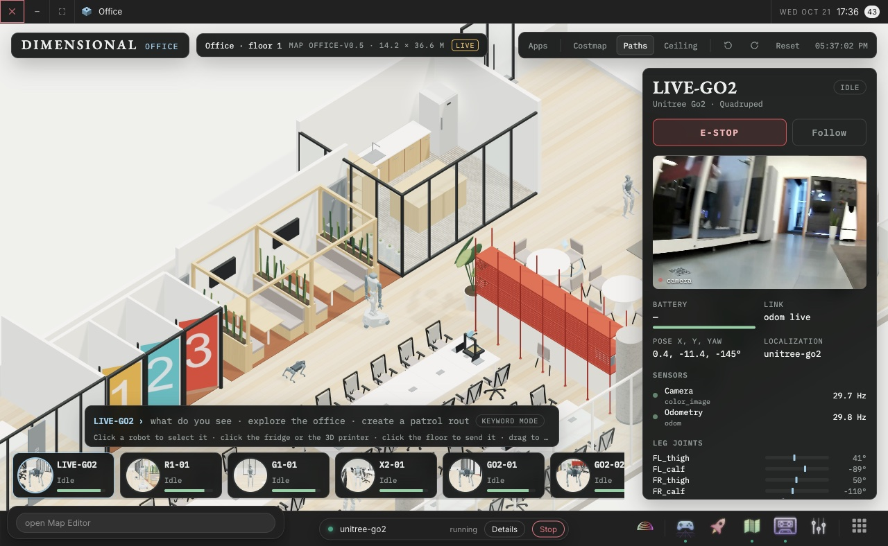
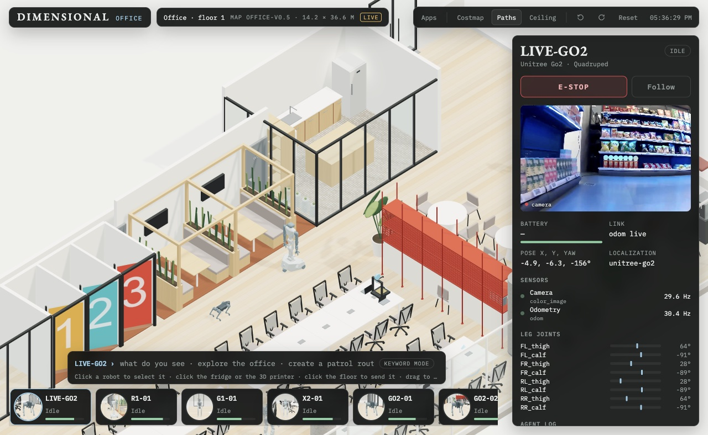

# dim-office

An isometric office where robots are selected like Sims and tasked through pie menus, an action queue and a command
line. A [dimOS Desktop](https://github.com/dimensionalOS/dimos-desktop) app, ported from the "Dimensional Desktop"
concept artifact.



On its own, at `http://localhost:5555/apps/dim-office/`:



```sh
dimos-desktop install https://github.com/jeff-hykin/dim-office
```

With a blueprint running, its robot joins the office as `LIVE-<KIND>` (Go2, G1, R1 or X2 by the blueprint's name),
through the same gateways as [dim-controller](https://github.com/jeff-hykin/dim-controller):

- its `odom` places it, relative to where it stood when the page opened (the office is not a map of the real room)
- floor clicks and navigation skills send a goal on its goal input (`goal_request` on a Go2); a cancel or E-STOP sends a goal at its current pose
- W/A/S/D or the arrow keys drive it on `cmd_vel` while held, with the gateway's deadman armed
- `color_image` is its camera in the side panel

Every other robot is simulated. Manipulation, the Claude command line and the app store are the concept's mock-ups
(the command line answers with a keyword parser).

Robot URDFs and meshes: Unitree G1 and Go2 (BSD-3-Clause), Galaxea R1 Pro (Apache-2.0), AgiBot X2 Ultra (Mulan PSL
v2); each license is in `frontend/robots/<kind>/`.
